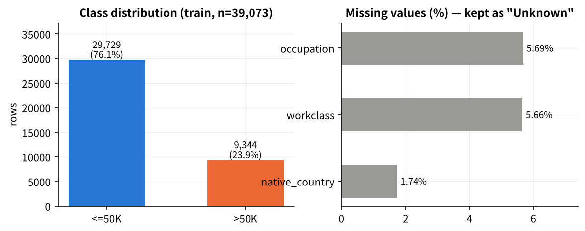
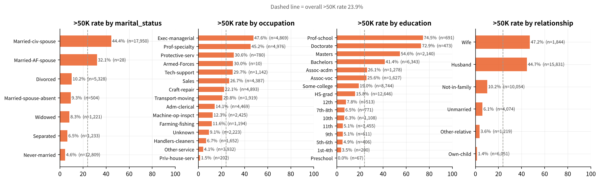
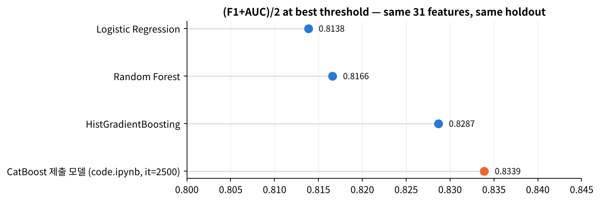
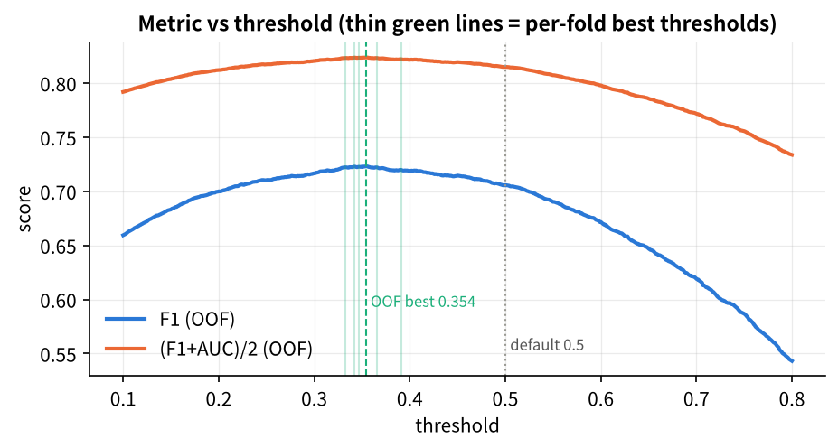
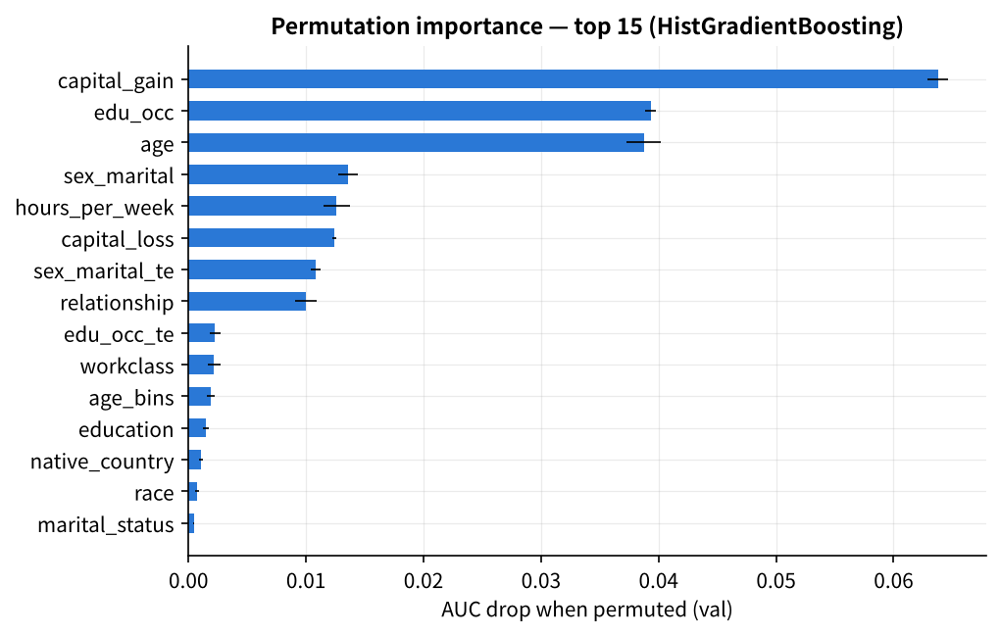
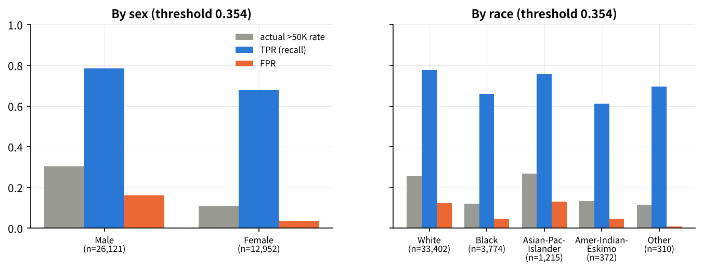

# 💰 소득 예측 (Income Prediction) — CatBoost

> **Pattern Recognition (02)** 최종 팀프로젝트 · Team 16 · Ewha Womans University · 2026-05-31 제출
> 개인의 인구통계·근로 정보로 **연소득 $50K 초과 여부**를 예측하는 이진 분류


%2F2-0.8339-orange)

| | |
| --- | --- |
| **최종 모델** | CatBoost (iterations 2500 · lr 0.02 · depth 7 · l2 10, early stopping) + threshold 0.422 |
| **검증 성능 (holdout)** | AUC **0.9306** · F1 **0.7373** · `(F1+AUC)/2` = **0.8339** |
| **같은 조건의 다른 모델** | Logistic Regression 0.8138 · Random Forest 0.8166 · HistGradientBoosting 0.8287 |
| **핵심 전략** | 피처를 무작정 늘리지 않고, CatBoost가 단일 행으로 학습할 수 없는 신호(OOF Target Encoding · Group Aggregation)만 추가 |
| **제출 후 보완** | 다중 모델 비교 · 피처 ablation · 검증 방식 점검 · 모델 해석 · 오류/공정성 분석 → [`notebooks/analysis.ipynb`](notebooks/analysis.ipynb) |

---

## 👤 담당 역할 — 유다연

> Team 16 (4인) · 아래는 본인이 담당한 파트

- **CatBoost 모델링 · 하이퍼파라미터 튜닝** — 범주형 11개를 `cat_features`로 직접 전달, `iterations=2500 · learning_rate=0.02 · depth=7 · l2_leaf_reg=10` + `early_stopping_rounds=200`으로 과적합 억제, stratified holdout(31,258 / 7,815)으로 검증
- **Threshold 최적화** — 평가식 `(F1+AUC)/2`에 맞춰 0.1~0.8 구간을 0.001 간격으로 탐색해 **0.422** 선택 (F1 0.7373 · AUC 0.9306 · 최종 0.8339), 전체 train 재학습 후 `prediction.csv` 생성
- **피처 엔지니어링 파이프라인 적용 · 검증** — 팀 Base FE 6개 위에 KFold(5) Out-of-Fold Target Encoding 5개(smoothing=10)와 Group Aggregation 7개를 쌓아 13 → 31개 변수 파이프라인 구성, train-only fit 원칙과 train/test 인코딩 분포 차 0.003 이내 확인으로 누수 검증
- **전처리** — 결측(`?`/빈칸)을 대체하지 않고 `Unknown` 카테고리로 보존하는 전략 (결측 집단 고소득 비율 9.1% vs 24.8%)
- **보고서** — 모델링 · Threshold · 결론 파트 작성
- **제출 후 보완 (2026-11)** — `notebooks/analysis.ipynb` 추가: 동일 피처로 3개 모델 비교, 피처 블록 ablation, Target Encoding 누수 점검, 5-fold CV, permutation importance, 오류 분석, 성별·인종 공정성 분석

---

## 🎯 문제 정의 & 데이터

- **문제 유형**: 이진 분류 (`<=50K` → 0, `>50K` → 1) · **평가 지표**: `(F1 score + AUC) / 2`
- **데이터** (강좌 배포 `train.csv` / `test.csv`, UCI Adult 계열)
  - train 39,073 × 15 · test 9,769 × 14 (타겟 없음, `id` 유지 필수)
  - 클래스 분포 `<=50K` 76.1% vs `>50K` 23.9% (약 3:1 불균형)
  - 결측은 `workclass` 5.66% · `occupation` 5.69% · `native_country` 1.73%, `workclass` 결측은 전부 `occupation`도 결측

| 구분 | 변수 |
| --- | --- |
| 수치형 | `age`, `education_num`, `capital_gain`, `capital_loss`, `hours_per_week` |
| 범주형 | `workclass`, `education`, `marital_status`, `occupation`, `relationship`, `race`, `sex`, `native_country` |
| 타겟 | `income` |

---

## 🔍 EDA 요약



- **수치형 상관**: `education_num`(0.335) > `age`(0.230) > `hours_per_week`(0.227) > `capital_gain`(0.223)
- **규칙형 신호**: `capital_gain`이 5,000을 넘으면 고소득 비율이 20% → 82% → 99%로 급증, 99,999인 206명은 전원 고소득
- **범주 간 편차**: `Married-civ-spouse` 44.4% vs `Never-married` 4.6%, `Prof-school` 74.5% vs `HS-grad` 15.8%, `Exec-managerial` 47.6% vs `Priv-house-serv` 1.5%
- **성별 격차의 출처**: 전체로는 남 30.4% vs 여 10.9%지만, **`Married-civ-spouse` 안에서는 남녀가 44~45%로 거의 같다** → 격차의 상당 부분은 혼인상태 구성비 차이 (여성 표본의 기혼 비율 15% vs 남성 61%)



→ 선형 관계보다 **조건이 충족될 때 클래스가 갈리는 비선형 패턴**이 강하다 → 트리 기반 부스팅 모델이 적합

---

## 🔬 접근 방법 (Pipeline)

원본 **13개 입력 변수 → 31개**. 모든 단계는 `fit(train) → transform(test)` 원칙으로 누수를 막는다.

| 단계 | 내용 | 변수 수 |
| --- | --- | --- |
| 클리닝 | 결측(`?`/NaN) → `Unknown` 보존, 문자열 `strip()` | 13 |
| Base FE | `cap_net`, `has_capital_stats`, `gain_per_hour`, `age_bins`, `sex_marital`, `edu_occ` | 19 |
| Target Encoding | `occupation`, `native_country`, `edu_occ`, `sex_marital`, `workclass` — **5-fold OOF**, smoothing 10 | 24 |
| Group Aggregation | `occupation`×[age, education_num, hours] · `native_country`×[education_num, hours] · `workclass`×[age, hours] 그룹 평균 | 31 |
| 모델 | CatBoost, `cat_features` 11개 직접 전달, stratified holdout 80/20 | |
| Threshold | `(F1+AUC)/2` 기준 0.1~0.8 정밀 탐색 → 0.422 | |

**의도적으로 배제한 기법**: StandardScaler · IsolationForest · Winsorize/log1p · 단순 binary 파생 — 트리 모델에서 정보 이득이 없거나 노이즈로 확인

```python
CatBoostClassifier(
    iterations=2500, learning_rate=0.02, depth=7,
    l2_leaf_reg=10, bagging_temperature=0.8, random_strength=1,
    border_count=254, early_stopping_rounds=200, random_seed=42
)
```

---

## 📊 결과

### 제출 모델 (CatBoost, holdout)

| 지표 | 값 |
| --- | --- |
| Validation AUC | **0.9306** |
| Validation F1 (threshold 0.422) | **0.7373** |
| **`(F1+AUC)/2`** | **0.8339** |
| Test 예측 분포 | `0` 7,474 / `1` 2,295 |

### 여러 모델 비교 — 같은 31개 피처, 같은 holdout ([`analysis.ipynb` §3](notebooks/analysis.ipynb))

| 모델 | AUC | F1@0.5 | best threshold | F1@best | `(F1+AUC)/2` @best |
| --- | --- | --- | --- | --- | --- |
| Logistic Regression (One-Hot + 표준화) | 0.9159 | 0.6792 | 0.340 | 0.7117 | 0.8138 |
| Random Forest (500 trees) | 0.9167 | 0.6845 | 0.343 | 0.7165 | 0.8166 |
| HistGradientBoosting | 0.9264 | 0.7093 | 0.408 | 0.7309 | 0.8287 |
| **CatBoost (제출 모델)** | **0.9306** | – | 0.422 | **0.7373** | **0.8339** |



선형 모델 < RF < GBDT 순으로 올라가고, 범주형을 내부에서 처리하는 CatBoost가 가장 높았다. threshold를 0.5에서 0.34~0.42로 내리면 모든 모델에서 F1이 0.02~0.03 오른다.

---

## 🧪 제출 후 추가 분석 — [`notebooks/analysis.ipynb`](notebooks/analysis.ipynb)

과제 안내문이 요구한 "여러 모델 비교 · 모델 해석 · 오류 분석 · 공정성 분석"을 제출 파이프라인과 같은 피처 위에서 수행했다. 아래 수치는 scikit-learn `HistGradientBoosting` 기준이며, 노트북은 `catboost`가 설치된 환경에서 실행하면 같은 분석을 CatBoost로 다시 계산한다.

### 1. 피처 블록 ablation — "cross-row 통계만 기여했다"는 주장 검증

| 피처 구성 | 변수 수 | AUC | F1@best | `(F1+AUC)/2` | Δ |
| --- | --- | --- | --- | --- | --- |
| 원본 13개 (클리닝만) | 13 | 0.9282 | 0.7336 | 0.8309 | – |
| + Base FE 6개 | 19 | 0.9263 | 0.7254 | 0.8258 | −0.0051 |
| + Target Encoding 5개 | 24 | 0.9262 | 0.7266 | 0.8264 | −0.0045 |
| + Group Aggregation 7개 (최종) | 31 | 0.9264 | 0.7309 | 0.8287 | −0.0022 |

HistGradientBoosting에서는 피처 블록 간 차이가 ±0.005로 **5-fold 표준편차(0.0069) 안**에 있다. 즉 이 모델에서는 파생 피처가 유의미한 이득을 주지 않았고, 보고서의 주장은 CatBoost 기준 ablation으로 확인해야 한다 (노트북을 CatBoost 환경에서 재실행하면 표가 자동으로 바뀐다). 한편 permutation importance에서는 `edu_occ`·`sex_marital` 상호작용 피처가 원본 `education`·`marital_status`를 대체해 상위에 오른다 — 정보가 새로 생긴 게 아니라 **표현이 옮겨간 것**이다.

### 2. 검증 방식 점검

| 점검 항목 | 결과 |
| --- | --- |
| Target Encoding을 split **전에** 계산 (현재) vs split **후** train 통계만 사용 | 0.8287 vs 0.8268 → **+0.0019 낙관 편향** (train 행 인코딩에 val 타겟이 섞임) |
| 5-fold CV (fold마다 split-first 인코딩) | `(F1+AUC)/2` **0.8245 ± 0.0069**, fold별 0.8168~0.8332 |
| fold별 최적 threshold | 0.333~0.391 (std 0.023) → 단일 holdout의 0.422는 분할에 따라 흔들리는 값 |
| threshold 민감도 | F1이 최대값−0.01 이내인 구간 **0.27~0.46** → 정확한 값보다 "0.5를 쓰지 않는다"는 결정이 중요 |



### 3. 모델 해석 — permutation importance (holdout AUC 하락량)

`capital_gain`(0.064) > `edu_occ`(0.039) > `age`(0.039) > `sex_marital`(0.014) > `hours_per_week`(0.013) > `capital_loss`(0.012) > `sex_marital_te`(0.011) > `relationship`(0.010). EDA에서 본 자본소득 규칙·학력×직업·연령이 그대로 상위에 온다.



### 4. 오류 분석 (OOF 예측, threshold 0.354)

- 혼동행렬: TN 26,388 · FP 3,341 · FN 2,161 · TP 7,183 → precision 0.683 · recall 0.769
- **False Negative(고소득을 놓침)** 는 양성이 드문 집단에 몰린다: 학력 `9th` FN율 84%, `Never-married` 53%, 25세 이하 61%
- **False Positive** 는 반대로 양성이 흔한 집단에서 높다: `Doctorate` FP율 53%, `Married-civ-spouse` 31%
- 모델이 "집단의 기본 비율"에 크게 기대고 있어, 집단 평균에서 벗어난 개인을 틀린다

### 5. 공정성 분석 — 성별 · 인종 (과제 안내문의 추가 분석 항목)

| 그룹 | n | 실제 >50K | 예측 양성률 | TPR | FPR | AUC |
| --- | --- | --- | --- | --- | --- | --- |
| Male | 26,121 | 0.304 | 0.350 | 0.785 | 0.161 | 0.905 |
| Female | 12,952 | 0.109 | 0.106 | 0.677 | 0.036 | 0.944 |
| White | 33,402 | 0.254 | 0.288 | 0.776 | 0.123 | 0.921 |
| Black | 3,774 | 0.121 | 0.121 | 0.660 | 0.047 | 0.949 |
| Asian-Pac-Islander | 1,215 | 0.268 | 0.297 | 0.757 | 0.129 | 0.895 |



- 예측 양성률 격차는 실제 양성률 격차를 거의 그대로 따른다. 다만 **TPR은 여성이 0.11p, Black이 0.12p 낮다** → 소수 집단의 고소득자를 더 많이 놓친다 (equal-opportunity 격차)
- **혼인상태를 통제하면 격차가 사라진다**: `Married-civ-spouse` 안에서는 TPR 남 0.817 vs 여 0.825, FPR 0.308 vs 0.298 → 모델이 성별 자체보다 혼인상태·가구관계를 통해 간접적으로 반영
- 표본이 적은 집단(`Amer-Indian-Eskimo` 372, `Other` 310)의 지표는 불안정하다

---

## 💭 한계와 다음 단계

1. **검증 설계**: Target Encoding·Group Aggregation을 fold 안에서 계산하고, 단일 holdout 대신 **CV 평균±표준편차**로 보고해야 한다. 제출 수치 0.8339는 약 +0.002의 낙관 편향과 ±0.007의 분할 분산을 안고 있다.
2. **피처 효과의 모델 의존성**: HistGradientBoosting에서는 파생 피처 이득이 없었다. CatBoost에서 같은 ablation을 돌려 "어떤 블록이 실제로 기여했는지"를 숫자로 남기는 것이 다음 단계다.
3. **학습 길이**: 제출 모델의 `bestIteration = 2498 / 2500` → early stopping이 발동하지 않았다. iterations를 늘리거나 learning rate를 올리면 성능이 더 오를 여지가 있다.
4. **중복 행**: train에 `id`를 제외하면 완전히 같은 행이 4,482건(11.5%) 있다. 같은 프로필이 train/val 양쪽에 들어가면 holdout 성능이 부풀 수 있어, 중복을 묶는 GroupKFold도 검토할 만하다.
5. **공정성**: TPR 격차를 줄이려면 그룹별 threshold나 재가중을 시도할 수 있지만, `sex`·`race`를 입력에서 빼는 것만으로는 해결되지 않는다(혼인상태·가구관계가 대리 변수).

---

## 📂 프로젝트 구조

```
income-prediction-catboost/
├── README.md
├── code.ipynb                  # 제출용 파이프라인 (CatBoost) — prediction.csv 재현 + feature importance
├── notebooks/
│   └── analysis.ipynb          # 추가 분석: EDA · 모델 비교 · ablation · 검증 점검 · 해석 · 오류/공정성
├── src/
│   ├── features.py             # 클리닝 · Base FE · OOF Target Encoding · Group Aggregation (code.ipynb와 동일 로직)
│   ├── evaluate.py             # (F1+AUC)/2 · threshold 탐색 · 그룹별 공정성 지표
│   └── viz.py                  # 그림 스타일
├── results/
│   ├── figures/                # README에 쓰인 그림 9장
│   ├── model_comparison.csv · ablation_feature_blocks.csv · cv_5fold.csv
│   └── te_leakage_check.csv · permutation_importance.csv · fairness_by_group.csv
├── prediction.csv              # 2026-05-31 제출본 (id, y_cls, y_prob)
├── report.pdf                  # 최종 보고서
├── requirements.txt
├── data/README.md              # 데이터 배치 안내 (원본 미포함)
└── _posts/                     # 깃허브 블로그 포스트
```

---

## 🚀 실행 방법

```bash
git clone https://github.com/dayeon-yu/income-prediction-catboost.git
cd income-prediction-catboost
pip install -r requirements.txt

# 강좌 배포 데이터를 data/ 에 배치 (data/README.md 참고)
#   data/train.csv  (39,073 × 15)
#   data/test.csv   (9,769 × 14)

jupyter notebook code.ipynb                 # 제출 파이프라인 → prediction.csv (CPU 약 6분)
cd notebooks && jupyter notebook analysis.ipynb   # 추가 분석 (HistGB 기준 약 1분, CatBoost 기준 약 15분)
```

Google Colab에서는 `code.ipynb` 상단의 `TRAIN_PATH`/`TEST_PATH`를 Drive 경로로 바꾸면 된다. 두 노트북 모두 `random_state=42`로 고정되어 있다.

---

## 📄 산출물

- 📓 [`code.ipynb`](./code.ipynb) — 제출 파이프라인 (재현 가능)
- 📓 [`notebooks/analysis.ipynb`](./notebooks/analysis.ipynb) — 추가 분석 (실행 결과 포함)
- 📈 [`prediction.csv`](./prediction.csv) — 테스트셋 예측 결과
- 📑 [`report.pdf`](./report.pdf) — 최종 보고서
- ✍️ [블로그 포스트](./_posts/2026-05-31-income-prediction-with-catboost.md) — 프로젝트 회고

<div align="center">

**Pattern Recognition · Team 16 · Ewha Womans University · 2026**

</div>
